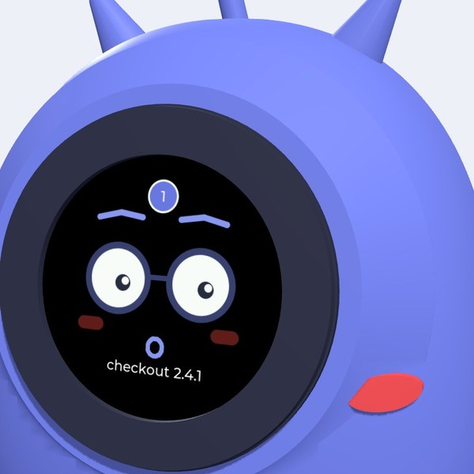
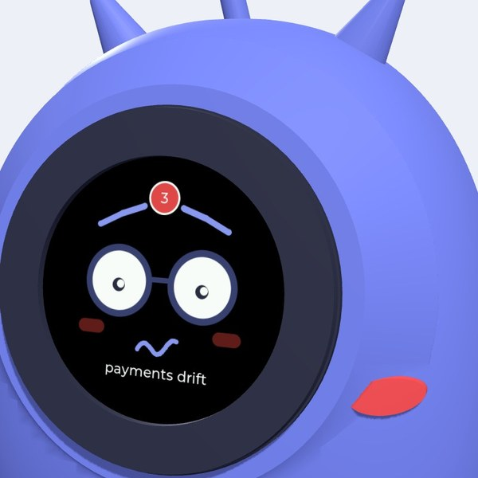
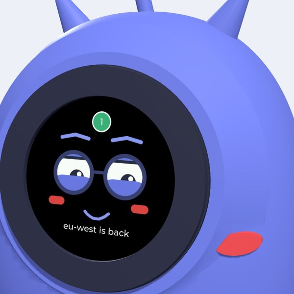
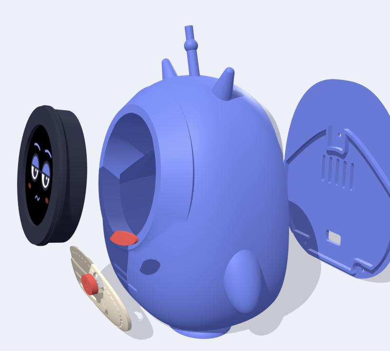
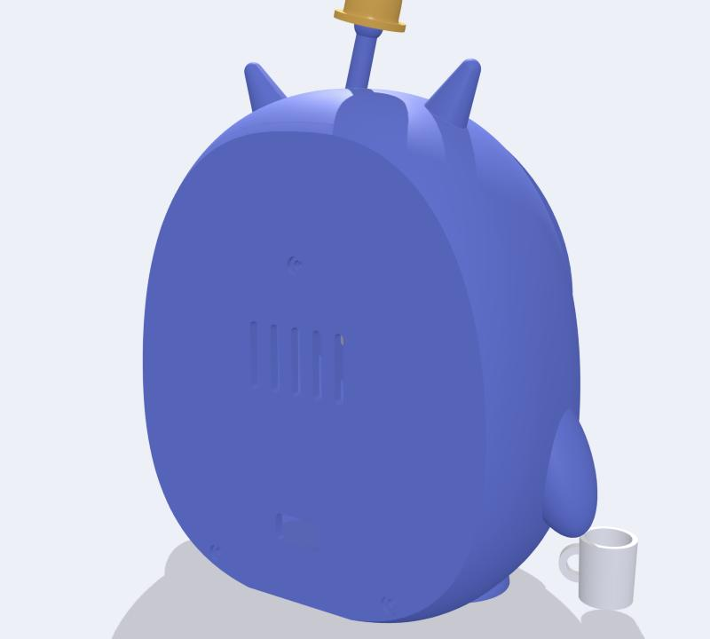
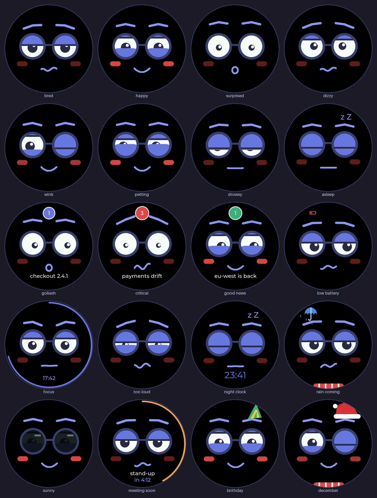
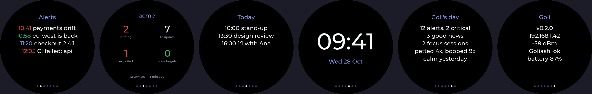
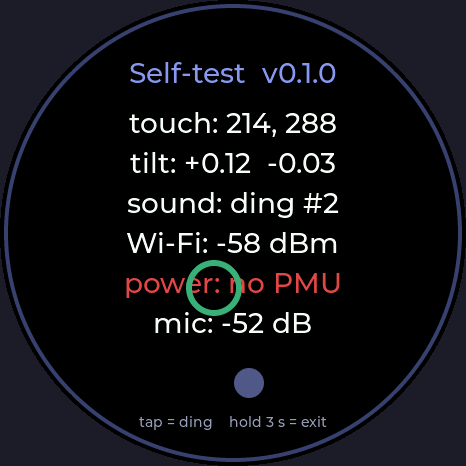
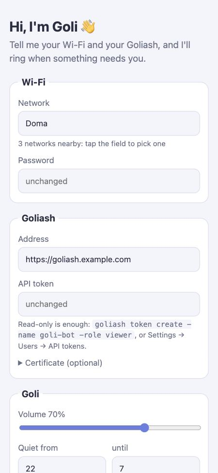

# Goli desk bot

A printable desk robot of **Goli**, the Goliash mascot: tired, kind, always one more alert away from a coffee.
His whole face is a round AMOLED with an ESP32-S3 behind it, so the eyes, brows and mouth are animated.


| Something new | Something on fire | Good news |
|---|---|---|
|  |  |  |

| Exploded | Back |
|---|---|
|  |  |

**[Try him in your browser](https://pipozzz.github.io/goli-bot/sim/)** · **[Install the firmware from your browser](https://pipozzz.github.io/goli-bot/)** · **[3D viewer](https://pipozzz.github.io/goli-bot/viewer.html)** (also `viewer.html` here, with an exploded-assembly slider)

**Status:** designed and checked in CAD, **not printed yet**. Print the bezel and bracket first (about 20 min)
and test-fit them on the display before you print the body.

## Size

About 108 × 65 × 150 mm with the bell on. Every part fits the Bambu Lab A1 mini (180 mm³).

## Parts to buy

| Part | Notes |
|---|---|
| [Waveshare ESP32-S3-Touch-AMOLED-1.75](https://www.waveshare.com/wiki/ESP32-S3-Touch-AMOLED-1.75) | 466×466 round AMOLED with touch, ESP32-S3, IMU, mic, speaker amp, LiPo charger and RTC. Get the version **without** the case. |
| Speaker, 8 Ω 1 W, about 20×30 mm, MX1.25 plug | Glue it behind the belly card; the two "message lines" are the grille. |
| 3× M2×6 machine screws | Bracket → the board's M2 nuts |
| 3× M2×6 self-tapping screws | Bracket → bezel |
| 3× M2×8 self-tapping screws | Back plate → body |
| USB-C cable | Goes through the slot in the back plate. A right-angle plug fits best. |
| Optional: 3.7 V LiPo (~1000 mAh, MX1.25) | Sits in the base. The board's power button is inside the body, so plan for USB power or leave the board on. On battery the screen goes dark after he has slept for 30 min; touch or move him to wake him. |

## Print

| File | Colour | Orientation | Notes |
|---|---|---|---|
| `goli_body_blue.stl` + `goli_belly_cream.stl` + `goli_accents_red.stl` | blue / cream / red | upright, as exported | One multi-colour object (see below). Tree supports, build plate only, for the arm undersides. |
| `goli_bezel_navy.stl` | navy | face down | No supports. |
| `goli_bracket_any.stl` | any | as exported | No supports. |
| `goli_backplate_blue.stl` | blue | outer face down | No supports. |
| `goli_bell_yellow.stl` | yellow | lip down | No supports. |
| `goli_mug_white.stl` | white | upright | Optional prop: "coffee #4". |

PLA, 0.2 mm layers (0.12 mm for the bell and mug), 3 walls, 15 % gyroid.

The inside of the body is designed to print without supports: the roof is a 45° cone, and the face socket
and screw bosses have 45° undersides.

**Multi-colour body (AMS lite):** open **`stl/goli_body_multicolor.3mf`** in Bambu Studio. It is one object
with three parts already on filaments 1–3 (blue, cream, red), set up for the A1 mini with 0.20 mm layers,
3 walls, 15 % gyroid and tree supports from the plate. Map the three filaments to your AMS slots and print:
about 17 h and 150 / 58 / 13 g of blue / cream / red PLA, purging included.
With a single colour, just print `goli_body_blue.stl`. The belly, card and cheeks stand out in relief either way.

To rebuild the 3MF after changing the model, run `python3 make_3mf.py`. It uses Bambu Studio's command line,
so Bambu Studio must be installed.

## Assembly

1. Glue the speaker behind the belly grille, with the plug pointing up.
2. Drop the display into the bezel from behind, glass first. The lip holds the glass by its black border.
3. Screw the bracket to the board's three back nuts (M2×6). The board's USB-C port points **down**, through
   the notch in the bezel.
4. Push the bezel into the face socket from the front. From inside, screw the bracket to the bezel tube
   (3× M2×6 self-tapping). The body wall is clamped between the bezel and the bracket.
5. Plug in the speaker (and the battery). Route the USB-C cable down and out through the back plate slot.
6. Close the back plate (3× M2×8). Press the bell onto the antenna peg; add a drop of glue if it is loose.

## Firmware

`firmware/` is a PlatformIO project: Arduino core 3 (via pioarduino), LVGL 8.4, the CO5300 driver from
GFX Library for Arduino, SensorLib for touch and IMU, Espressif's ES8311 codec driver, and ArduinoJson.



| Input | Goli |
|---|---|
| nothing happening | tired: heavy lids, worried brows, wavy mouth; blinks and glances around |
| new alert (Goliash, GitHub, a script...) | **ding** of a desk bell, surprised face, count badge, title scrolling under the mouth |
| something critical (agent gone quiet, vulnerability, production drift...) | **ding-ding**, alarmed face, red badge |
| good news (an agent is back, a drift was resolved) | chirp, happy face, green badge |
| tap the face | boop: surprised, then happy with blushing cheeks; also marks alerts as seen |
| 2 quick taps | wink |
| 3 quick taps | focus mode (a pomodoro) on / off: 25 minutes by default, a blue ring counts down, only critical alerts ring; happy when it's over, then a 5-minute break with a green ring and "back to it?" (both lengths on the web page; 3 taps skip a break) |
| 5 quick taps | setup mode (QR code on the screen) |
| 10 quick taps | demo mode for a booth (any tap stops it) |
| swipe across the face | latest alerts → Goliash overview → today's meetings → big clock → Goli's day → status |
| knock twice on the desk | snooze: alerts stay silent for 10 minutes |
| a meeting in 10 minutes | an amber ring counts down, its name under his mouth; a ding when it starts |
| during a meeting | alerts stay silent (badge only, critical ones still ring), "in a meeting" under his mouth |
| an alert arrives | he hops, and the badge breathes until you've seen it (faster when critical) |
| nothing happens for a while | every few minutes a glance around, a look at the clock, a silent yawn |
| rain / sun / frost coming | umbrella / sunglasses / scarf |
| your birthday, December | party hat, Santa hat |
| a Goli next to him rings | he looks that way |
| finger resting on / stroking the face | petting: blissful closed eyes |
| clap | marks alerts as seen (wink), or just startles him |
| loud noise for a while | winces |
| tilt him | pupils roll with the tilt |
| shake him | dizzy, pupils spinning, wobbly sound |
| bump or pick him up | surprised |
| 1 min idle → 5 min idle, or lying flat | drowsy → asleep with a yawn (screen dims, "z Z", breathing, the time under his eyes) |
| hold a finger still for 3 s | turns the face by 90° (saved): use it once after assembly |
| finger on the face while he starts | self-test screen (see *Checking the assembly*) |
| battery low, or charging | battery icon next to the bell |
| production deploy on a Friday after 15:00 | winces: "on a Friday?!" |

The whole face drifts by a few pixels over minutes so the AMOLED does not burn in.

### Pages



Swipe across his face for the **latest alerts** (time coloured by level), **Goliash at a glance** (drifting services, updates waiting, updates that fix
exploited vulnerabilities, stale targets; from `GET /api/v1/summary` every 5 minutes; only when Goliash is
set up), **today's meetings**, a **big clock**, **Goli's day** (alerts, good news, how often you petted
him, focus sessions done, and whether yesterday was rough) and **Goli's status** (version, IP, Wi-Fi, connections, battery,
weather). A tap or 30 s goes back to the face.

The time comes from NTP and is kept by the board's RTC, so the clock is right after a restart even
before Wi-Fi is up.

### Ears

The board has two microphones. Goli only measures how loud it is, on the device; nothing is recorded or
sent, and he ignores his own sounds. A clap marks alerts as seen; a noisy room makes him wince.
Turn it off on the web page.

### His day

- **Language:** Goli's words on his face (greetings, pages, hints) in English, Slovak, Czech or German,
  chosen on the web page. The fonts have no accents, so it's "dobre rano!".
- **Reminders:** "14:00 call mum" once, every day or on weekdays, set on the web page. He rings with the
  title at that minute, even in quiet hours (you asked for it).

- **Mood follows yesterday:** after a day with many alerts (critical ones count three times) his resting
  lids are heavier the next morning. At midnight today becomes yesterday, and it survives a restart.
- **Desk buddy** (on by default): the first time someone is at the desk in the morning he says good
  morning (happy birthday on your birthday) with the day in one line, like "3 meetings, rain later"; after 50 minutes at the desk he suggests a stretch and some
  water; on Friday after 17:00 he tells you to go home. "At the desk" means a touch, or voices and typing
  heard by the microphones in the last few minutes.
- **Knock knock:** two quick knocks on the desk (felt by the IMU) snooze alerts for 10 minutes. The
  threshold is a guess until it meets a real desk.
- **Night:** with *Screen off at night* on, his screen goes dark while he sleeps in quiet hours; a touch
  wakes him.
- **A team of Golis:** Golis on the same network find each other. On each one's web page, pick who sits
  on its left and right; when one rings, its neighbours look its way.

### Demo mode

Tap him 10 times: he loops through his faces and a few made-up Goliash alerts (a deploy, a critical
drift, an agent coming back) with sounds, no Wi-Fi needed. Any tap stops it. Made for a booth.

### Simulator

**<https://pipozzz.github.io/goli-bot/sim/>** runs Goli's firmware in the browser: `bot.cpp` (every
gesture, mood, alert, focus, demo and page), the face and the sounds, compiled to WebAssembly with LVGL.
The mouse is the finger; buttons stand in for Goliash alerts, the IMU (lean, nod, shake, bump, lay him
down), the microphones and the battery. Only the hardware glue in `main.cpp` is left out.

```bash
pio run -e snapshot -d firmware   # fetches LVGL
sim/build.sh                      # needs Emscripten (brew install emscripten)
python3 -m http.server -d sim/out
```

### Installing from the browser

No tools needed: open **<https://pipozzz.github.io/goli-bot/>** in Chrome or Edge on a computer, plug the
board in by USB-C and click **Install**. The page is built by GitHub Actions from every commit to `main`.

1. Use a USB-C cable that carries data. Pick the port (*USB JTAG/serial debug unit* or similar).
2. On the first install, let it erase the board. For updates, don't erase: Goli keeps his settings.
3. If no port shows up or it can't connect: hold **BOOT**, press and release **RESET**, release BOOT and try
   again. Press RESET once more when it's done.
4. Choose **Connect to Wi-Fi** when the installer offers it (Goli speaks [Improv](https://www.improv-wifi.com/)
   over USB). Then open the link it shows to add your Goliash address and token on Goli's setup page.
   No Wi-Fi step? Set him up from your phone instead (below).

The page always installs the latest [release](https://github.com/pipozzz/goli-bot/releases).

### Updates over Wi-Fi

Once Goli is on your Wi-Fi he updates himself: a few minutes after starting and then once a day he reads
`ota.json` from the installer site, and if a different release is out he downloads it, says *updating
myself...* and restarts. The download only comes from a server with a trusted certificate (the roots are in
`src/tls_roots.h`), and the ESP32 checks the image before it boots it. Turn it off on the web page.
Builds you make yourself are versioned `dev` and never update themselves.

Safari and phones can't flash (no Web Serial). Every release also has `goli-firmware.bin`, a merged image for
offset 0x0: `esptool.py --chip esp32s3 write_flash 0x0 goli-firmware.bin`.

### Checking the assembly



Keep a finger on his face while he starts (about a second) for the self-test. A ring follows your finger, a
bubble level shows the tilt, every tap rings the bell, and it shows Wi-Fi signal and battery. Red means the
part didn't answer. Hold 3 s to leave. If the ring isn't under your finger, the touch panel is rotated or
mirrored against the display.

### Building it yourself

```bash
cd firmware
pio run -t upload        # board in USB-C; hold BOOT while plugging in if upload does not start
pio device monitor
```

The build also writes `.pio/build/goli/goli-firmware.bin` (`tools/merge_bin.py`).

**Releasing:** push a tag like `v0.2.0`. GitHub Actions builds that version, creates the release with both
images, and publishes the installer and `ota.json` to Pages; every Goli on Wi-Fi picks it up within a day.
Pushes to `main` and pull requests only build and render the faces. To try the installer page
locally, run `web/build_site.sh` and serve `site/` with `python3 -m http.server -d site`; Web Serial works on
`localhost`.

`include/config.h` holds brightness, default volume, timezone, the idle timeouts and the tilt directions. If the pupils roll the wrong way
when you tilt Goli, flip `TILT_ROLL_SIGN` / `TILT_PITCH_SIGN`.

Preview every expression without the board (renders `docs/faces.png`):

```bash
pio run -e snapshot && .pio/build/snapshot/program && python3 tools/sheet.py
```

### Sounds

Goli synthesizes all his sounds (no audio files). Pick one for each kind of alert on the web page:

| Sound | What it is |
|---|---|
| Desk bell, Desk bell twice | a brass desk bell (inharmonic partials with different decays); twice and a tone lower for critical |
| Ship's bell | lower and longer, struck twice like on a ship |
| Marimba, 8-bit, Coin, Water drop | a wooden arpeggio, a chiptune arpeggio, a game coin, a drop |
| Whisper | a soft "pff" and a tick, for an office |
| Goli: "hm?", "ou!", "ehh...", "ya-ay!" | his own voice: formant synthesis, a buzz shaped into vowels, nothing recorded |
| Your own sound | any audio file, uploaded on the web page (first 3 seconds, converted in the browser) |

With **Goli talks** on, he also says "hm?" when booped and "ya-ay!" when happy. Hear everything in
`docs/sounds/` (re-render: the command at the top of `firmware/tools/render_sounds.cpp`) or in the
simulator. The speaker amp is only on while a sound plays. During quiet hours (22:00 to 07:00 by default)
alerts are silent and only the badge appears.

### Setting Goli up (from a phone or a PC)

On first start, Goli has no Wi-Fi yet, so he opens a setup hotspot and shows a QR code. To set him up again
later, **tap his face 5 times** quickly.

| On Goli's screen | On your phone |
|---|---|
|  |  |

1. Scan the QR code with the phone camera to join `Goli-XXXX`. The password is on the screen and changes
   every time.
2. The setup page opens by itself (captive portal). If it doesn't, scan the second QR code or open `192.168.4.1`.
3. Pick your Wi-Fi, enter your Goliash address and API token, and set volume and quiet hours. Then tap **Save**.
   Goli restarts and joins your Wi-Fi.

A PC works the same way: join the `Goli-XXXX` Wi-Fi and open `192.168.4.1`. Everything is stored in Goli's flash.
Saved passwords and the token are never shown back on the page; leave a field empty to keep the old value.
If the Wi-Fi or the token stops working, a hint appears at the bottom of his face.

Why not Bluetooth: setting a device up over Bluetooth from a web page (Web Bluetooth) doesn't work on iPhone.
The hotspot works on every phone and computer without an app.

### Managing Goli from a browser

Once Goli is on your Wi-Fi, open **`http://goli-xxxx.local/`** (the status page shows the name and IP).
The first time, click *Show me a code*: Goli shows a 6-digit code on his face, and typing it pairs the
browser (5 wrong tries and the code is gone, and every further round makes you wait twice as long). Only someone standing next to Goli can pair. From then on
everything is there:

- **Home:** connections, his mood, **alerts today by hour** (a small chart), **his face live** (a snapshot every 2 seconds), **reminders**, today's meetings, the
  latest alerts; boop him, start focus or the demo, test alerts.
- **Sounds:** a sound per kind of alert with a play button, Goli talks, volume, quiet hours, your own sound.
- **Alerts:** Goliash (optional), which alerts ring, GitHub, URLs to keep an eye on, the key for scripts.
- **Day:** calendar, weather, desk buddy, birthday, the microphones, the team.
- **Goli:** Wi-Fi, Home Assistant, language, night, updates, **install a firmware file** (`goli-app.bin`
  from a release, or your own build: no USB needed once he's assembled), **backup and restore** (every
  setting and reminder, secrets included, in one JSON file), restart, setup mode, forget this browser.

Secrets (Wi-Fi password, tokens, the calendar address) are never shown back. The setup hotspot (tap 5
times) still works for the first setup or a new Wi-Fi.

### Sources

Everything is optional; Goli is happy with none of them, and Goliash is just one of them.

| Source | What Goli does |
|---|---|
| **Goliash** | notifications by severity, the overview page (see below) |
| **Calendar**: secret iCal addresses (Google, Outlook, iCloud, Nextcloud), up to 4, separated by spaces | today's meetings on a page, an amber countdown ring 10 minutes before each, a ding when it starts. Daily and weekly repeats (with skipped dates) are expanded; monthly ones and moved single instances are not. Times are taken in Goli's time zone. Checked every 10 minutes. |
| **Weather**: a location (*Use my location* on the web page) | from [Open-Meteo](https://open-meteo.com/) every 30 minutes: an umbrella with rain falling when rain is likely in the next 8 hours, sunglasses on a sunny 20 °C+ day, a scarf at 2 °C or snow |
| **GitHub**: a classic token with the `notifications` scope | review requests and mentions ring; failed CI on your pull requests and security alerts ring as critical. Checked every minute. |
| **Keep an eye on**: up to 6 URLs | fetched every minute; two failures in a row is critical ("shop.example.com is down"), and he's happy when it's back |
| **Anything else**: `POST /notify` | see *Ring Goli from anything* |

HTTPS to these services is checked against the Mozilla root certificates built into ESP-IDF; the watched
URLs only check that a site answers, so their certificates are not checked.

### Goliash alerts

Create a read-only token for the web page (or the setup page): `goliash token create -name goli-bot -role viewer`
(or *Settings → Users → API tokens*). Make sure a notify rule sends what you care about; any channel counts.
To keep alerts inside Goliash only, use the *In Goliash* channel.

Every 30 s Goli asks `GET /api/v1/notifications/sent?since=…`, the same list the bell in the Goliash UI
shows. Each message newer than the last one he saw rings once. The first poll after power-on only learns
where things stand, so he doesn't ring for old news. If you leave the certificate field empty, the
Goliash certificate is not checked.

**Which alerts ring** is up to you on the web page: everything or only critical ones, only production,
only some services (comma-separated). Items without an environment or service, like an agent going
quiet, always pass the production and service filters.

**Instant alerts with a webhook:** if your Goliash can reach Goli on your network, add a *Webhook*
channel in Goliash with the URL `http://goli-xxxx.local/notify` (or his IP; the status page shows both)
and Goli's key as the secret, point a notify rule at it, and tick *Goliash sends alerts to me* on the web page. Goli checks the
`X-Goliash-Signature` on every request and stops polling for notifications. He still asks for the summary
every 5 minutes, which also tells him the token works. (Goliash in Docker may not resolve `.local`
names: use the IP then, and give Goli a fixed address in your router.)

### Home Assistant

Fill in your MQTT broker on the web page (*Goli* tab; the Mosquitto add-on works). Goli announces
himself with MQTT discovery and shows up as a device:

| Entity | What it is |
|---|---|
| Unseen alerts, Mood, Alerts today | sensors |
| Focus, Someone at the desk | binary sensors (an occupancy sensor for automations) |
| Boop, Focus on/off, Demo on/off | buttons |
| Ring Goli | a notify entity: `notify.send_message` with a message rings him |

For a level, publish `{"title": "Washing machine done", "level": "good"}` to `goli/goli-xxxx/notify`.
Goli marks himself offline in Home Assistant when he loses the broker.

### Ring Goli from anything

Goli listens on your network: `POST /notify` with a JSON `title` and an optional `level`
(`info`, `critical` or `good`), and his key from the web page (Alerts tab).

```bash
curl -H "Authorization: Bearer <key>" -H "Content-Type: application/json" \
  -d '{"title":"nightly build failed","level":"critical"}' http://goli-xxxx.local/notify
```

He answers `202` with `ringing`, or `filtered out` when *only critical* is on and it isn't; without the
JSON content type he answers `415`. `GET /status`
returns his version, Wi-Fi signal and Goliash connection, without secrets.

From GitHub Actions on a self-hosted runner in the same network:

```yaml
- if: failure()
  run: |
    curl -fsS -H "Authorization: Bearer ${{ secrets.GOLI_KEY }}" -H "Content-Type: application/json" \
      -d '{"title":"${{ github.repository }}: ${{ github.workflow }} failed","level":"critical"}' \
      http://goli-xxxx.local/notify
```

From Home Assistant (`configuration.yaml`), then call `rest_command.goli` from any automation:

```yaml
rest_command:
  goli:
    url: http://goli-xxxx.local/notify
    method: post
    headers:
      Authorization: !secret goli_bearer   # "Bearer <key>"
    content_type: application/json
    payload: '{"title": "{{ title }}", "level": "{{ level | default(''info'') }}"}'
```

**Monitoring tools, as they are:** Alertmanager (Prometheus), Grafana alerting and Uptime Kuma can post
straight to `http://goli-xxxx.local/notify`. Goli understands their webhook formats: firing alerts ring
(critical when the `severity` label is critical), resolved ones and monitors coming back up are good
news, a monitor going down is critical. Give the key as a Bearer header, or in the address
(`/notify?key=...`) for tools that can't set headers; the address then contains the key, so keep it
inside your network.

Titles show in ASCII; common accented letters are folded (č → c).

Developers can pre-fill the settings at build time: copy `firmware/include/secrets.example.h` to `secrets.h`
(git-ignored). It is only used while nothing has been saved on the device.

## Changing the design

Everything is generated by `goli_bot.py`: the body silhouette is the Bézier path from the Goli artwork, and the
display's dimensions are constants at the top of the file.

```bash
python3 -m venv .venv && .venv/bin/pip install -r requirements.txt
.venv/bin/python goli_bot.py      # writes stl/ (print-oriented) and stl/assembly/ (assembled positions)
.venv/bin/python make_viewer.py   # rebuilds viewer.html
```

Useful knobs: `S` (overall scale), `FACE_TILT` (how far the face looks up), `K` (body depth),
`FIT` (clearance for press fits), and the `PCB_NUTS` / `GLASS_R` / `NUT_DEPTH` constants if you use another display.
The display's mechanical drawing is in `docs/waveshare-amoled-1.75-dimensions.jpg`.

## License

| What | License |
|---|---|
| Firmware (`firmware/`), web installer (`web/`), CI and the Python tools | [MIT](LICENSE) |
| 3D model (`stl/`, `goli_bot.py` and what it generates, `viewer.html`), the Goli character, renders and artwork in `docs/` | [CC BY-NC-SA 4.0](LICENSE-MODEL.txt) |
| ES8311 codec driver (`firmware/lib/es8311/`) | Apache-2.0, © Espressif Systems |
| Clock digits (`firmware/src/font_clock.c`, rendered from Montserrat) | SIL Open Font License 1.1 |
| ES7210 register sequence in `firmware/src/mic.cpp` | follows Espressif's esp_codec_dev driver, Apache-2.0 |

Print, remix and share Goli for non-commercial use: credit "Goli desk bot by Peter Gonda" with a link to this
repository and share remixes under the same license. Selling prints or remixes needs written permission.
